  

  

I build where hardware meets software: robot navigation, vision-language-action policies, sensor pipelines and flight software. Most of my time goes into ROS 2, RViz, Gazebo and anything that moves.

| | Expedition | Depth reached |
|---|---|---|
| 🤖 | **VLA robotics**: SmolVLA on RoboCasa, working toward a bimanual kitchen robot | simulation → policy |
| 🛞 | **RViz ManualControlTool**: ROS 2 plugin for arcade-style keyboard driving | ROS 2 · C++ |
| 🛩️ | **ArduPilot**: contributing to open-source flight software | C++ · upstream |
| 🧵 | **PET filament sensor**: Hall-effect diameter gauge for recycled filament, ISEF 2024 | hardware · research |

  

  
  

  

  

